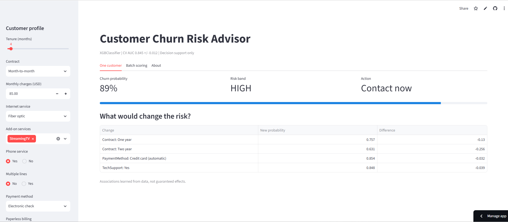
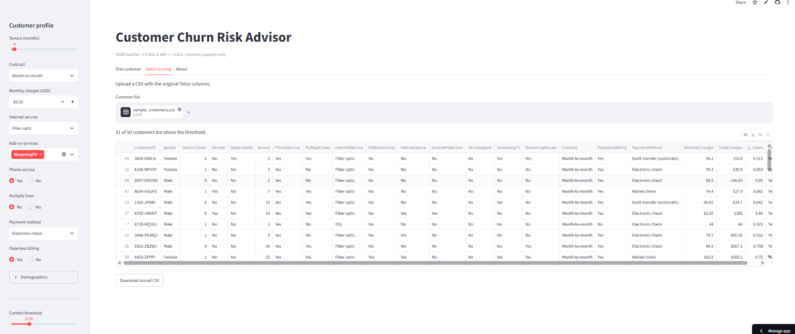

# Churn Risk Advisor v1.0

## Model card: Churn Risk Advisor v1.0
- Intended use: rank existing telecom customers by churn risk so a retention team can prioritize calls. Decision support, not automation.
- Not for: credit, pricing, or any decision that denies a service.
- Data: IBM Telco Customer Churn, 7,043 customers, 26.5% churn.
- Model: XGBClassifier, chosen by 5-fold CV. Features: 30 encoded columns.
- Performance: CV AUC 0.8502 +/- 0.012; test AUC 0.848 (test set used once).
- Threshold: 0.30, from a cost analysis (FN = PKR 6,000, FP = PKR 1,000).
- Limitations: one US dataset from one period; no Pakistan data; associations, not causes; performance may drift as plans change.
- Fairness check (Week 15): compare recall across gender and seniors.
- Owner and version: Mahum Junaid, v1.0, 2026-10-09.

## Live App
* **URL:** https://churn-risk-advisor-inrvjcl5wdsnferw2nziyx.streamlit.app

## Screenshots
* **One Customer View:**
  

* **Batch Scoring View:**
  


## Reflections & Lab Writeups
* **Surprising Behavior:** Watching the "What would change the risk?" recommendations update dynamically in real time based on changes to parameters like contract type or payment methods.
* **Handling Difficult Inputs:** Extreme or out-of-range inputs (such as negative tenures or abnormally inflated monthly charges) can still cause friction or unhandled edge cases since strict UI bounds aren't fully enforced.

## Written Insights & Check Your Understanding

### Deployment Experience
* **Public URL:** https://churn-risk-advisor-inrvjcl5wdsnferw2nziyx.streamlit.app
* **Deployment Outcome:** The first deployment succeeded on Streamlit Community Cloud after matching the Python version (3.11) and dependencies in `requirements.txt`.

### Check Your Understanding Answers
1. **Why `get_dummies(drop_first=True)` breaks single-customer scoring:** When encoding a single row, missing categorical levels alter the total column count or order, causing a feature mismatch with the trained model.
2. **Parity test purpose:** It compares raw model predictions against serialized pipeline predictions across all training rows to ensure feature engineering and preprocessing remain identical after export.
3. **Caching models (`st.cache_resource`):** `st.cache_resource` caches global, non-serializable objects (like loaded ML models) across reruns, avoiding expensive file reads on every user interaction.
4. **Derived TotalCharges:** Deriving `TotalCharges = Tenure * MonthlyCharges` prevents user input contradictions (e.g., setting Tenure to 0 with high TotalCharges) and ensures logical consistency.
5. **Exact scikit-learn version pinning:** ML pickling/joblib serialization relies on internal class structures that can change between library versions, causing deserialization or inference errors.
6. **Two-year contract offer impact:** While contract length correlates strongly with lower churn, offering one doesn't guarantee retention; controlled A/B testing is required to confirm causal retention.

## How to Run Locally
Clone the repository and run the following commands in your terminal:
```bash
python -m venv .venv
.venv\Scripts\activate
pip install -r requirements.txt
streamlit run app.py